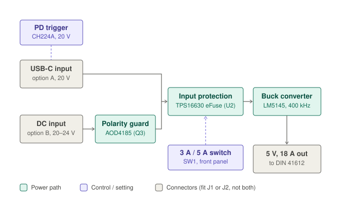

# USB-PD 5 V power card (3U Eurocard)

A 3U Eurocard (100 × 160 mm) that makes **5 V at up to 18 A** (17 A continuous rating) for the
DDS backplane, from either a **100 W USB-C PD charger** (20 V / 5 A) or a **20–24 V DC supply**.
Status: **design stage** — values calculated, BOM priced on LCSC (2026-10-01), no schematic yet.

Files in this folder:

| File | What it is |
|---|---|
| `block_diagram.svg` | The diagram above |
| `BOM_LCSC.csv` | BOM with LCSC part numbers + prices (LCSC BOM tool / JLC assembly column names) |
| `design_calcs.py` | Ripple, compensation, loop-stability and loss calculations (`uv run --with numpy python design_calcs.py`) |

## Requirements

- 5 V out, as many amps as a 100 W USB-C charger allows (~18 A after ~93 % efficiency).
- Input from a USB-C PD charger (20 V / 5 A, needs a 5 A e-marked cable) **or** 20–24 V DC.
- 3U 100 × 160 mm Eurocard; 5 V leaves through a DIN 41612 type C connector; all inputs and
  controls on the front panel.

## Build options — fit ONE input

The PCB has footprints for both inputs, but each board is assembled with **only one** of
them, so two sources can never be connected at the same time (BOM notes mark which parts
belong to which build):

| Build | Fit | Leave empty |
|---|---|---|
| **A — USB-C** | J1, U5 (CH224A), R16, C27, C28 | J2, Q3, D7, R23 |
| **B — DC 20–24 V** | J2, Q3 (AOD4185), D7, R23 | J1, U5, R16, C27, C28 |

Mark "fit J1 OR J2" on the silkscreen. Because only one source is ever present, no
ideal-diode / OR-ing stage is needed (an earlier revision had two LM74700s for that).

## How it works

Power flows left to right in the diagram.

1. **Build A:** the **CH224A (PD trigger)** talks to the charger over the USB-C CC lines and
   asks for 20 V. It carries no power. (Replaces the CH224K, which LCSC lists as discontinued.)
   VBUS goes straight to the eFuse.
2. **Build B:** the **AOD4185 polarity guard (Q3)** passes the DC input to the eFuse and
   blocks it if the DC cable is wired backwards (see below).
3. **TPS16630 eFuse (U2)** decides *when* power is let through and *how much*: a 16.2–26.7 V
   voltage window, a 3 A / 5 A current limit chosen by SW1, and a soft 5 ms turn-on.
4. **LM5145 buck converter (U1)** with external MOSFETs Q1/Q2 and a 2.2 µH inductor turns
   20–24 V into 5.00 V at 400 kHz.
5. **5 V output** leaves through 16 parallel DIN 41612 pins (plus 16 GND pins).

### Reverse-polarity guard (build B only)

USB-C cannot be plugged in backwards (VBUS and GND are in the same place either way), but a
DC cable can be **wired** backwards even with the keyed XT30. The TPS16630 input is rated
only to −0.3 V, so a reversed supply would destroy it.

Q3 is a P-channel MOSFET in the DC path: drain to J2 +, source to the eFuse input, gate
pulled to GND through R23 (10 kΩ). With correct polarity the gate sits ~12 V below the
source and the MOSFET is fully on (~15 mΩ → ~0.4 W at 5 A). With reversed polarity the gate
cannot turn on and the MOSFET blocks. D7 (12 V zener, gate to source) keeps the gate-source
voltage inside the MOSFET's ±20 V rating at 20–27 V input. The surge diode D1 sits after Q3,
so a reversed supply never forward-biases it.

### TPS16630 — eFuse (both builds)

An eFuse is an electronic fuse: a 31 mΩ power switch inside the chip, controlled by
protection circuits. Unlike a normal fuse it acts in microseconds, resets itself, and can be
configured. This board uses five of its functions:

| Function | Setting | What it protects |
|---|---|---|
| **Under-voltage lockout** | On at 16.2 V, off at 15.1 V (R11/R12/R13) | Before PD negotiation, USB-C sits at 5 V, so the eFuse stays **off** and the charger never sees the board's large input capacitors (USB-C allows only ~10 µF before negotiation). Chargers that only offer 5/9/12/15 V are rejected. |
| **Over-voltage cutoff** | Off above 26.7 V | Disconnects if someone plugs a 28 V+ supply into the DC input (build B). The chip itself survives up to 60 V, protecting the buck converter and capacitors behind it. |
| **Current limit** | 2.98 A (SW1 = 3 A, R14) or 5.32 A (SW1 = 5 A, R14 ∥ R15) | Keeps the board below the charger's rating, so the board limits itself instead of the charger tripping and cutting out. Also handles shorts: fast trip at 2× the limit, hard short shut-off in ~1 µs. |
| **Soft start (dV/dt)** | 0 → 20 V in ~5 ms (C26 = 12 nF) | Charging ~200 µF of input capacitance draws only ~0.7 A instead of a large spike. |
| **Thermal shutdown** | Auto-retry | If the limit is held too long, the chip overheats → turns off → retries. |

Status pins (PGOOD, FLT) drive front-panel LEDs; IMON (current monitor) is available for
future monitoring.

**Division of labour:** Q3 = *which direction* current may flow (build B only).
TPS16630 = *when and how much*, in both builds.

## Design values

Source: TI LM25145 / LM5145 datasheets (LM5145 is the pin- and parameter-identical 75 V
sibling of the LM25145; values apply to both). The power stage follows TI's datasheet
"Design 1" (24 V → 5 V, 20 A).

### LM5145 buck (U1)

| Function | Part | Value | Result |
|---|---|---|---|
| Switching frequency | R1 (RT) | 24.9 kΩ | 400 kHz |
| Output voltage | R2 / R3 (FB) | 23.2 kΩ / 4.42 kΩ | 5.00 V |
| Input turn-on | R4 / R5 (EN/UVLO) | 200 kΩ / 17.4 kΩ | On 15.0 V, off 13.0 V |
| Soft-start | C18 | 47 nF | 3.8 ms |
| Current limit (low-side RDS(on) sensing) | R6 / C19 | 249 Ω / 22 pF | ~27 A typ (≥21 A worst case) |
| Compensation (Type III) | R7, R8, C20, C21, C22 | 18.2 kΩ, 1.62 kΩ, 4.7 nF, 47 pF, 2.2 nF | Crossover ~43 kHz, phase margin ~54° |
| SYNCIN | — | Tie to VCC | Fixed-frequency (forced PWM); can later be clocked externally |

Loop check (`design_calcs.py`): phase margin 54–55° across 0.5–18 A and 16–24 V; worst
component corner (very low-ESR polymer caps) 42°. Measure the loop on the first board.

### Power stage

| Part | Choice | Notes |
|---|---|---|
| Q1 high side | TI CSD18503Q5A (40 V, 3.7 mΩ) | |
| Q2 low side | TI CSD18511Q5A (40 V, 2 mΩ) | Its RDS(on) sets the current limit |
| L1 | Bourns SRP1265A-2R2M (2.2 µH, Isat 37 A, 4.2 mΩ) | Ripple 3.9–4.5 A p-p, peak 20.2 A at 18 A |
| Output caps | 4 × 220 µF polymer (6TPE220MI, 18 mΩ) + 6 × 47 µF X7R 1210 | ~1000 µF; ripple ~7 mV p-p |
| Input caps | 6 × 10 µF 50 V X7R 1210 + 100 µF 35 V hybrid polymer | Input ripple current 7.3–8.4 A RMS |

Estimated losses at 18 A / 20 V: ~5.3 W total → ~94 % (expect 92–94 % on a real board).
Use 2 oz copper, dense thermal vias under Q1/Q2/L1; a small fan above ~15 A continuous.

## Backplane and front panel

**DIN 41612 type C, 96-pin (3 × 32), right-angle male on the card.** Plan ~1–1.2 A per pin
(type C contacts are ~1.5–2 A each, derated for neighbouring pins all carrying current):

| Pins | Use |
|---|---|
| Positions 1–6, rows a/b/c (18) | 5 V — 16 used + 2 spare |
| Positions 7–12, rows a/b/c (18) | GND |
| Positions 13–32 (~60) | Signals (TBD) |

16 contacts in parallel ≈ 1 mΩ → ~20 mV drop at 18 A. Connect each block to a plane or wide
2 oz pour on both card and backplane. **Do not hot-plug** cards into a powered backplane.

**Front panel (8 HP suggested):** USB-C (6-pin power-only, 5 A) or XT30 DC input, depending on build; SW1
3 A / 5 A slide switch (default 3 A), LEDs: input OK / 20 V negotiated / 5 V power-good / fault.

## Open items

- [ ] CH224A 20 V configuration resistor (R16) — check the CH224A datasheet.
- [ ] LED resistor values (R17–R20).
- [ ] Check AOD4185 Rds(on) at Vgs = −12 V in its datasheet.
- [ ] Verify the USB-C 6-pin receptacle is rated ≥ 5 A and the DIN 41612 part is male / type C.
- [ ] Decide customization (monitoring, backplane enable/power-good, rack-clock sync, extra rails).
- [ ] Choose EDA tool (existing boards in `PCB_designs/` are Altium).
- [ ] Run values through TI's LM5145 Quickstart Calculator / WEBENCH with final part numbers.

## References

- [TI LM25145 datasheet](https://www.ti.com/lit/ds/symlink/lm25145.pdf) — Design 1: 24 V → 5 V, 20 A
- [TI LM5145 datasheet](https://www.ti.com/lit/ds/symlink/lm5145.pdf)
- [TI TPS1663 (TPS16630) datasheet](https://www.ti.com/lit/ds/symlink/tps1663.pdf)
